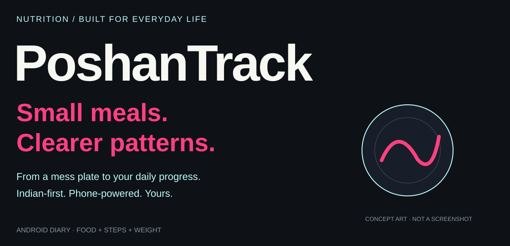
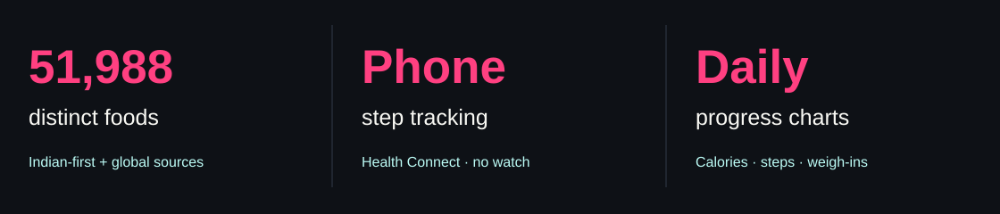

<p><picture><source media="(max-width: 600px)" srcset="assets/readme/hero-mobile.svg"/></picture></p>

<p align="center"><a href="#what-i-built">Overview</a> · <a href="#from-plate-to-progress">Workflow</a> · <a href="#photo-analysis">Photo AI</a> · <a href="#run-locally">Setup</a> · <a href="#privacy-and-scope">Privacy</a> · <a href="#explore-the-source">Source</a></p>

I built PoshanTrack for everyday eating between classes, campus walks and hostel meals. It is an Android-first nutrition diary for gradual gain, loss or maintenance, with optional onboarding answers, Indian-first food search and daily progress charts.

<a id="what-i-built"></a>
## What I built



- **51,988 distinct foods:** regional Indian recipes first, followed by USDA generic foods and 38,000 branded products. This is not a claim of 50,000 Indian recipes. See [food provenance](FOOD_DATA_SOURCES.md).
- **Flexible quantities:** pieces, grams, supported mL conversions and custom servings. Nutrition scales with the amount logged.
- **Meal diary:** photos, timestamps, editable macros, confirmation before saving and menu-based deletion with recalculated totals.
- **Progress:** 7/30-day calorie, step and weight charts, older-period browsing and exact dated values. Missing logs stay unknown; weight appears only for actual weigh-ins.
- **Phone steps:** Health Connect daily readings and available recent-history backfill. No watch is required; a supported phone step source is needed.
- **Personal planning:** optional gain/loss/maintenance goals, unknown-input options, weight/supplement logs and no-blender hostel guidance.

<a id="from-plate-to-progress"></a>
## From plate to progress

Log food manually or submit a selected meal photo for an estimate. Confirm the dish, portion, oil and macros before saving. Charts aggregate saved meals, recorded steps and weigh-ins. History does not disappear at midnight; today's summary changes to the new calendar day.

Couples and friends can **manually share** progress using Android's share sheet. This version has no live shared cloud diary, login service, subscriptions or payment screens.

<a id="photo-analysis"></a>
## Photo analysis

The optional Node server keeps provider keys off the phone. Gemini gets a bounded attempt; configured Groq can handle quota exhaustion and recoverable timeouts, provider/network errors or invalid nutrition output. Both results pass the same nutrient bounds and macro-consistency checks. Cancellation and no-analysis/safety responses are not automatically routed around.

Uploads are authenticated before parsing, restricted to JPEG/PNG/WebP up to 6 MB, and protected by rate, concurrency and daily limits. Logs contain safe diagnostic labels rather than photos, descriptions or keys. The server does not intentionally persist uploads. Manual logging remains available offline when free AI services are unavailable.

Keep provider projects on Free plans without billing. The app cannot inspect billing settings or guarantee free usage of a key from an upgraded project. Photo portions and calories are estimates—not measured precision. See [backend setup](BACKEND_SETUP.md) and [server environment example](server/.env.example).

<a id="run-locally"></a>
## Run locally

```bash
git clone https://github.com/adilsukumar/PoshanTrack-Nutrition-Tracker.git
cd PoshanTrack-Nutrition-Tracker
corepack enable
pnpm install --frozen-lockfile
pnpm start
```

Expo SDK 57 / React Native 0.86 require Node 22.13+. Expo Go cannot exercise native Health Connect; use an Android development/release build. Local APK builds require JDK 17 and the Android SDK/NDK. Generated native folders and signing credentials are intentionally excluded.

```bash
pnpm exec tsc --noEmit
pnpm exec expo lint
node scripts/check-catalogue.cjs
node scripts/check-measures.cjs
node scripts/check-progress.cjs
node scripts/check-meal-delete.cjs
node scripts/check-daily-photo.cjs
cd server
pnpm install --frozen-lockfile
node --test *.test.mjs
```

Copy `server/.env.example` to `server/.env` and fill it privately. Start the server using `node index.mjs` from `server`. In Profile enter only your trusted HTTPS origin and private client code, never AI provider keys. [render.yaml](render.yaml) supplies deployment defaults; credentials must be entered separately.

| Role | Technology |
|---|---|
| Android interface | React Native, TypeScript, Expo Router |
| Diary | SecureStore journal; app-private photos |
| Steps | Android Health Connect |
| Photo server | Node.js, Express, Gemini, optional Groq |
| Foods | Indian recipe estimates; USDA SR Legacy/FNDDS/branded records |
| Charts | Lightweight native views |

<a id="privacy-and-scope"></a>
## Privacy and scope

Diary records use encrypted device storage. Photo files are app-private but not separately encrypted. Android automatic backup is disabled. Only photos explicitly submitted for analysis and their descriptions go to the configured server/providers; their data policies apply. A shared private client code is for trusted personal use, not individual-account security.

The published source excludes secrets, private screenshots, diaries, archives, APKs, signing files and build caches. Automated tests establish software behavior, not nutrition accuracy or physical-device/provider availability. Intermittent production failures motivated the bounded fallback update; successful live analysis must still be checked on the configured deployment.

Targets and estimates are planning tools, not diagnosis or treatment. Persistent unexplained weight loss deserves medical review. Supplement records do not establish deficiencies or prescribe products.

<a id="explore-the-source"></a>
## Explore the source

| Area | Source |
|---|---|
| Screens and food review | [App.tsx](App.tsx) |
| Daily charts | [progress.ts](src/progress.ts) · [ProgressCharts.tsx](src/ProgressCharts.tsx) |
| Foods and quantities | [indianFoods.ts](src/indianFoods.ts) · [foodMeasures.ts](src/foodMeasures.ts) |
| Encrypted diary | [storage.ts](src/storage.ts) |
| Steps | [healthConnect.ts](src/healthConnect.ts) |
| Provider orchestration | [providers.mjs](server/providers.mjs) |
| Server safety | [security.mjs](server/security.mjs) · [analysisValidation.mjs](server/analysisValidation.mjs) |

<details><summary><strong>Repository map</strong></summary>

```text
App.tsx             application screens and forms
src/                diary, foods, steps, charts and routing
server/             private photo proxy and tests
scripts/            importers, checks and build helpers
assets/readme/      charcoal, pink and cyan artwork
```

</details>

<p align="center"><a href="https://github.com/adilsukumar/PoshanTrack-Nutrition-Tracker/issues">Discuss an improvement</a> · <a href="FOOD_DATA_SOURCES.md">Food provenance</a> · <a href="https://www.adilsukumar.xyz/">Meet the builder</a></p>
